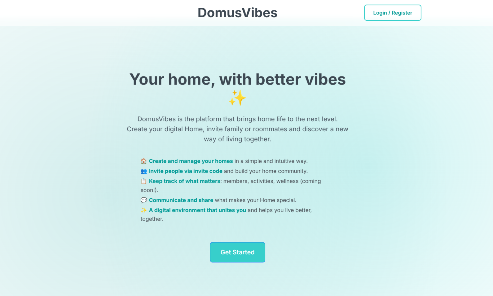

# DomusVibes 🏠✨

DomusVibes is a modern home-sharing and household management platform.  
It allows users to create homes, invite members, and manage shared living spaces in a simple and secure way.

The app is online at [domusvibes.vercel.app](https://domusvibes.vercel.app).



---

## 📦 Project Structure

```text
domusvibes/
│
├── backend/                 # .NET backend (Clean Architecture)
│   ├── DomusVibes.Api        # ASP.NET Core Web API
│   ├── DomusVibes.Application
│   ├── DomusVibes.Domain
│   ├── DomusVibes.Persistence
│   └── DomusVibes.sln       # Solution file
│
├── frontend/                 # Angular frontend
│   ├── src/
│   │   ├── app/
│   │   │   ├── pages/       # Page components
│   │   │   │   ├── welcome/     # Welcome/landing page
│   │   │   │   ├── login/      # Login/register page
│   │   │   │   ├── dashboard/  # User dashboard
│   │   │   │   ├── create-home/ # Create home page
│   │   │   │   ├── join-home/  # Join home page
│   │   │   │   └── home-details/ # Home details page
│   │   │   ├── services/    # API service
│   │   │   ├── styles/      # Global styles (SCSS variables, mixins)
│   │   │   ├── app.component.*
│   │   │   ├── app.config.ts
│   │   │   └── app.routes.ts
│   │   ├── assets/
│   │   │   ├── i18n/        # Translation files (en, de, es, fr, it)
│   │   │   └── logo_domus_vibes_app.png
│   │   ├── environments/    # Environment configs (dev/prod)
│   │   ├── index.html
│   │   ├── main.ts
│   │   ├── main.server.ts   # SSR entry point
│   │   ├── server.ts        # Express server for SSR
│   │   └── styles.scss      # Global styles entry
│   ├── public/
│   │   └── favicon.ico
│   ├── .vscode/             # VS Code settings
│   ├── angular.json         # Angular CLI config
│   ├── tsconfig.json        # TypeScript config
│   ├── tsconfig.app.json
│   ├── tsconfig.spec.json
│   ├── package.json
│   └── README.md
│
├── assets/
│   └── logo/                # Branding assets
│
├── docs/
│   └── business logic/      # Functional & domain documentation
│
├── docker-compose.yml       # PostgreSQL container
└── README.md

---

## 🚀 Tech Stack

### Backend
- **.NET 8** / **ASP.NET Core**
- **Entity Framework Core**
- **PostgreSQL**
- **Docker**
- **Swagger** / **OpenAPI**
- **MediatR** (CQRS pattern)
- **FluentValidation**
- **BCrypt.Net** (password hashing)

**Architecture:**
- Clean Architecture
- Domain-driven design (Entities, Aggregates, Repositories)
- CQRS with MediatR

### Frontend
- **Angular 21**
- **TypeScript**
- **RxJS**
- **Bootstrap 5**
- **ngx-translate** (i18n)
- **Angular SSR** (Server-Side Rendering)
- **SCSS**

**Architecture:**
- Standalone components
- Reactive forms
- Service-based API communication

🧠 Core Concepts

Users
Can register and authenticate.

Homes
A shared space created by a user.

Home Members
Users can join homes via invite codes.

🐳 Running the Project

### Prerequisites
- .NET 8 SDK
- Node.js (v18+ recommended)
- Docker & Docker Compose
- PostgreSQL client tools (optional, for database inspection)

### Backend Setup

1️⃣ **Start PostgreSQL with Docker**
```bash
docker compose up -d
```
PostgreSQL will be available on `localhost:5432`

2️⃣ **Run database migrations**
```bash
cd backend
dotnet tool restore  # Install EF Core tools if needed
dotnet ef database update -p DomusVibes.Persistence -s DomusVibes.Api
```

3️⃣ **Start the API**
```bash
dotnet run --project backend/DomusVibes.Api
```
The API will start on: **http://localhost:5200**  
Swagger UI: **http://localhost:5200/swagger**

### Frontend Setup

1️⃣ **Install dependencies**
```bash
cd frontend
npm install
```

2️⃣ **Start the development server**
```bash
npm start
# or
ng serve
```
The frontend will start on: **http://localhost:4200**

The frontend is configured to communicate with the backend API at `http://localhost:5200/api`.

🔌 API Endpoints

**Users:**
- `POST /api/users` – create a new user
- `POST /api/users/login` – authenticate user (email + password)

**Homes:**
- `POST /api/homes` – create a home
- `GET /api/homes/user/{userId}` – get all homes for a user
- `GET /api/homes/{homeId}` – get home details
- `POST /api/homes/join` – join a home
- `POST /api/homes/invite/join` – join a home with invite code
- `POST /api/homes/invite/generate` – generate invite code for a home
- `PUT /api/homes/update` – update home details
- `DELETE /api/homes/leave` – leave a home
- `DELETE /api/homes/remove` – remove a member from a home

🧪 Database
PostgreSQL
Managed via Entity Framework Core migrations
You can inspect the database using tools like DBeaver

🌱 Future Plans
- Authentication & authorization (JWT)
- Roles and permissions
- Home features (tasks, expenses, notifications)
- Real-time updates
- Deployment (Docker + CI/CD)

📄 License
Private project – all rights reserved.

👤 Author
Developed by etordev
